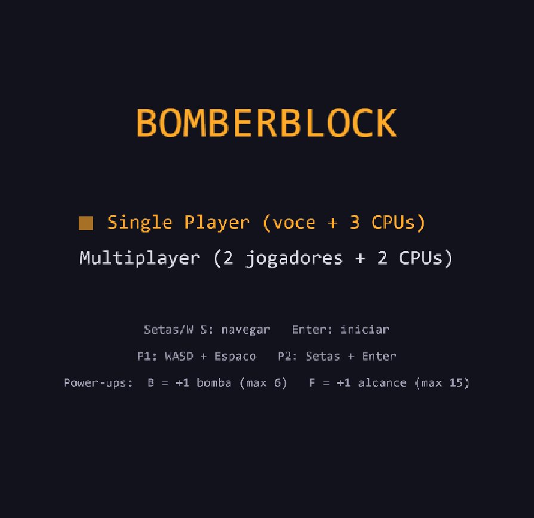
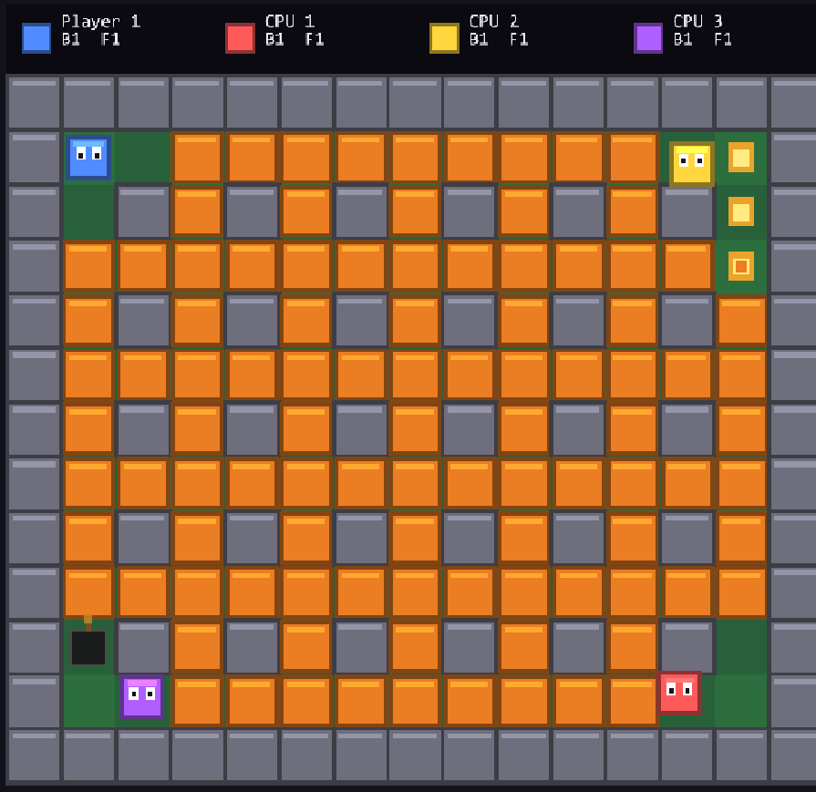

# BomberBlock

Jogo estilo Bomberman que roda **100% no navegador**, desenvolvido como teste técnico para vaga de dev full stack Node. A identidade visual segue o nome: **tudo é um bloco** — cenário, personagens, bombas e power-ups são cubos com bevel, desenhados por código (sem nenhum asset de imagem ou áudio).




## Como rodar (2 minutos)

**Pré-requisito:** [Node.js](https://nodejs.org/) 18 ou superior. Verifique com `node -v`.

```bash
git clone <url-do-repositorio>
cd clone-bomberman
npm install
npm run dev
```

Depois abra **http://localhost:5173** no navegador. Pronto — o jogo já está no ar.

> A porta 5173 está ocupada? O Vite escolhe outra automaticamente e mostra o link correto no terminal (ex: `http://localhost:5174`).

### Outros comandos

```bash
npm run build    # type-check (tsc) + build de produção em dist/
npm run preview  # serve o build de produção em http://localhost:4173
```

Não é necessário nenhum outro setup: sem banco de dados, sem variáveis de ambiente, sem assets para baixar.

## Como jogar

Toda partida tem **4 personagens** (modo batalha). Os humanos ocupam os primeiros slots e o restante é controlado pela CPU:

| Modo                  | Composição                            |
| --------------------- | ------------------------------------- |
| **Single Player**     | Você + 3 CPUs                         |
| **Multiplayer local** | 2 jogadores no mesmo teclado + 2 CPUs |

**Objetivo:** ser o último personagem vivo. Mortes simultâneas na mesma explosão resultam em empate, e a partida termina se todos os humanos forem eliminados.

### Controles

| Ação         | Player 1 (azul) | Player 2 (vermelho) |
| ------------ | --------------- | ------------------- |
| Mover        | `W` `A` `S` `D` | `←` `→` `↑` `↓`     |
| Soltar bomba | `Espaço`        | `Enter`             |

Menus: setas/`W`/`S` para navegar, `Enter` para confirmar. Na tela de fim de jogo: `R` = revanche, `Enter` = menu.

### Power-ups

Blocos destruídos têm 35% de chance de revelar um power-up — passe por cima para coletar (CPUs também coletam!). Explosões queimam power-ups já revelados.

| Power-up        | Efeito                    | Limite |
| --------------- | ------------------------- | ------ |
| **B** (cinza)   | +1 bomba simultânea       | 6      |
| **F** (laranja) | +1 de alcance da explosão | 15     |

## Regras do jogo

- Arena 15x13 no padrão clássico: totalmente preenchida com blocos destrutíveis, exceto paredes indestrutíveis e os 4 cantos de spawn
- Bombas com timer de 2,5s e explosão em cruz (alcance inicial de 1 tile)
- A explosão para em paredes, destrói no máximo 1 bloco por direção e detona outras bombas em cadeia
- A bomba só se torna sólida depois que o dono sai de cima dela
- HUD ao vivo com o status dos 4 personagens e placar de vitórias entre partidas

## Stack

- **[Vite](https://vite.dev/)** — build tool e dev server
- **[TypeScript](https://www.typescriptlang.org/)** — tipagem estática
- **[KAPLAY](https://kaplayjs.com/)** — engine de jogos 2D (sucessora da Kaboom.js)
- **Web Audio API** — efeitos sonoros 100% sintetizados em runtime (sem arquivos de áudio)

## Estrutura do projeto

```
src/
├── main.ts              # bootstrap: registra as cenas e abre o menu
├── config.ts            # todas as constantes de gameplay em um só lugar
├── kaplayCtx.ts         # contexto KAPLAY compartilhado
├── map.ts               # geração da arena e conversão tile <-> pixel
├── audio.ts             # efeitos sonoros sintetizados (Web Audio)
├── effects.ts           # partículas
├── visuals.ts           # helpers da identidade de blocos (bevel, shade)
├── scores.ts            # placar de vitórias entre partidas
├── scenes/
│   ├── menu.ts          # menu navegável
│   ├── game.ts          # montagem da partida, HUD e condição de vitória
│   └── gameover.ts      # resultado, placar, revanche
└── entities/
    ├── player.ts        # jogador, controles, stats e colisão por tile
    ├── bomb.ts          # bombas e explosões em cadeia
    ├── ai.ts            # CPUs (vagam, plantam com rota de fuga via BFS)
    └── powerup.ts       # spawn e efeito dos power-ups
```

## Roadmap

- [x] Power-ups (bomba extra, +alcance)
- [x] Efeitos sonoros sintetizados (Web Audio API, sem assets)
- [x] Efeitos visuais (screen shake, partículas, animações)
- [x] Identidade visual "BomberBlock" (blocos com bevel, sem assets)
- [x] HUD, menu navegável e placar de vitórias
- [ ] Multiplayer online — o modo atual é local no mesmo teclado
